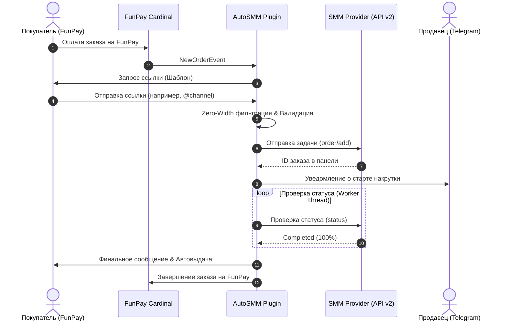

# AutoSMM — Автономная система накрутки для FunPay Cardinal

<p align="center">
  
  
  
  
</p>

**AutoSMM** — это мощный, автономный и полнофункциональный плагин для бота [FunPay Cardinal](https://github.com/sidor0912/FunPayCardinal) (`sidor0912/FunPayCardinal`), предназначенный для **100% автоматической обработки, передачи и завершения заказов на накрутку и SMM-услуги** (Telegram, ВКонтакте, Steam, YouTube, Twitch, TikTok, Instagram и др.).

Плагин полностью берёт на себя рутину продавца: от валидации ссылок покупателя до отправки в SMM-панели по SocPanel API v2, фонового мониторинга выполнения и автоматической выдачи товара.

---

## 🌟 Ключевые возможности

* 🛡️ **Zero-Width Unicode Sanitizer**: Полная фильтрация невидимых и экранирующих Unicode-символов (`\u200b`, `\u200c`, `\ufeff`, `\u202a`–`\u202e`) для защиты от повреждения ссылок и инъекций.
* 🔌 **SocPanel API v2 Multi-Provider**: Поддержка любых SMM-панелей, работающих по стандартному протоколу API v2 (SMMWay, Kuzya-Boost, SMMCode и др.).
* 🤖 **Telegram UI & Менеджер лотов**: Управление лотами, привязками услуг, наценками и балансами панелей прямо через Telegram-интерфейс Cardinal.
* 💬 **Кастомные шаблоны покупателю**: Гибко настраиваемые автоответы на всех стадиях заказа (приветствие, запрос ссылки, подтверждение, процесс накрутки, завершение).
* 💡 **PreSale Engine**: Определение намерений покупателей в предпродажном чате до оплаты и выдача интерактивных подсказок.
* 🔄 **Автовыдача и закрытие сделки**: Автоматическое подтверждение и выдача на FunPay сразу после успешного завершения накрутки провайдером.
* 🛡️ **Синхронизация возвратов**: Если покупатель оформил возврат на FunPay, плагин автоматически пытается отменить задачу в SMM-панели для сохранения баланса.
* 💾 **Автоматические бэкапы**: Создание полных резервных копий настроек и базы заказов перед критическими операциями.

---

## 📱 Поддерживаемые платформы и услуги

| Платформа | Доступные типы услуг |
| :--- | :--- |
| **Telegram** | Подписчики (каналы/группы), Просмотры постов, Реакции, Бусты каналов, Премиум-подписчики |
| **ВКонтакте** | Друзья, Подписчики в паблики, Лайки, Репосты, Просмотры историй и клипов |
| **Steam** | Комментарии в профиль, Награды сообщества, Накрутка часов |
| **YouTube** | Просмотры видео и Shorts, Лайки, Подписчики на канал, Часы просмотров |
| **Twitch** | Зрители на стрим, Фолловеры канала, Просмотры клипов |
| **TikTok** | Подписчики, Лайки, Просмотры, Репосты |

---

## 🏗️ Архитектура работы



---

## 📦 Установка

1. Убедитесь, что у вас установлен и настроен [FunPay Cardinal](https://github.com/sidor0912/FunPayCardinal).
2. Скачайте файл [`AutoSMM.py`](AutoSMM.py) из репозитория.
3. Поместите файл `AutoSMM.py` в папку `plugins/` вашего бота Cardinal:
   ```text
   FunPayCardinal/
   ├── plugins/
   │   └── AutoSMM.py   <-- поместить сюда
   └── storage/
   ```
4. Перезапустите Cardinal или отправьте команду `/plugins` в чат Telegram-управления.

---

## ⚙️ Настройка и команды

1. В чате управления ботом откройте меню плагинов или вызовите меню AutoSMM:
   * **API Сервисы**: Добавьте URL и API-ключ вашей SMM-панели (SocPanel API v2).
   * **Привязка лотов**: Свяжите ID услуг из панели с вашими лотами на FunPay и укажите множители количества.
   * **Шаблоны сообщений**: Настройте тексты сообщений для покупателей.

### Доступные переменные в шаблонах:
* `{order_id}` — ID заказа на FunPay
* `{link}` — ссылка покупателя
* `{amount}` — количество накрутки
* `{service_name}` — название выбранной услуги
* `{buyer_username}` — никнейм покупателя

---

## 🗺️ Планы на версию v0.1.0 (Flagship Release)
- [ ] ⚡ **Smart Multi-Provider Failover**: Автоматическое переключение на резервную SMM-панель при сбоях или нулевом балансе.
- [ ] 🔔 **Low-Balance Alerts**: Мониторинг балансов панелей с уведомлением в Telegram при остатке < 100 ₽.
- [ ] 📊 **Profit & Margin Engine**: Расчёт реальной маржи и защита от изменения цен поставщиками.
- [ ] 🔗 **Universal Link Normalizer**: Авто-распознавание приватных ссылок (`+hash`), шортсов и репостов.

---

## 📜 Хронология версий

Полная история изменений и архитектурный путь проекта доступны в документе [CHANGELOG.md](CHANGELOG.md).

---

## 👤 Автор

* Разработчик: **W1bbex** ([@w1bbex](https://t.me/w1bbex))
* Сайт: [https://w1bbex.ru](https://w1bbex.ru)
* GitHub: [@W1bbex](https://github.com/W1bbex)

## 📄 Лицензия

Проект распространяется под открытой лицензией [MIT License](LICENSE).
